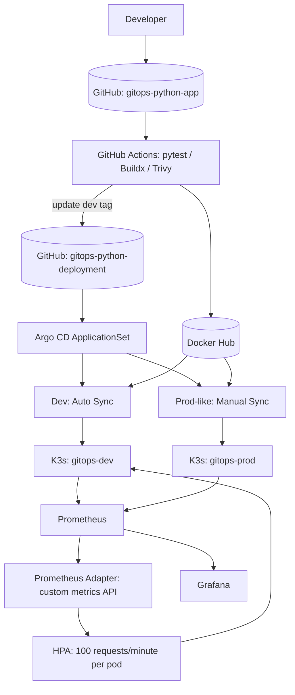

# Python GitOps Platform — Vault HA, Argo CD, Helm & Kubernetes

> **Hands-on DevOps portfolio | Kubernetes delivery, security, autoscaling, and observability**

An end-to-end, GitOps-driven delivery platform for a Flask API. Source changes pass through GitHub Actions and Docker Hub; image changes are committed to a separate Kubernetes configuration repository and reconciled by Argo CD. The platform includes request-based autoscaling through Prometheus Adapter, Prometheus/Grafana, and **HashiCorp Vault with a three-member integrated Raft cluster** for application secrets.

**Repositories:** [Python application](https://github.com/mrattdevops/gitops-python-app) · [GitOps configuration](https://github.com/mrattdevops/gitops-python-deployment)

**Environment boundary:** Both `gitops-dev` and `gitops-prod` are namespaces on a **single-node Rancher Desktop K3s cluster**. “Prod” denotes a production-style release policy—not a separate production infrastructure environment or node-level HA.

## Architecture



Editable diagram: [`assets/architecture.mmd`](assets/architecture.mmd).

## Tech stack

| Concern | Implementation |
|---|---|
| API | Python Flask, Gunicorn, pytest; `/health/live`, `/health/ready`, `/api/info`, `/metrics` |
| CI | GitHub Actions: tests, image build/push, vulnerability scanning, GitOps image-tag update |
| Registry | Docker Hub; SHA-tagged `docker.io/mrattdevops/gitops-advanced-app` |
| Deployment | Helm chart and Argo CD ApplicationSet; dev auto-sync, prod manual sync |
| Kubernetes | Rancher Desktop / K3s; dev request-based HPA via Prometheus Adapter |
| Observability | Prometheus, Grafana, ServiceMonitor, Kubernetes metrics |
| Secrets | Vault HA, integrated Raft, KV v2, Kubernetes auth, Agent Injector |
| Recovery | Manual Raft snapshot; manual Shamir unseal |

## What I implemented and verified

- **GitOps delivery:** CI updates a versioned image tag in Git; Argo CD reconciles dev automatically. Production-like releases require explicit promotion and manual sync.
- **Rollback:** Recovered a failed production-like deployment by restoring a previously working Git image tag.
- **Autoscaling:** Previous dev HPA tests scaled from 1 to 4 replicas under load and later returned to 1. The current manifests replace KEDA with Prometheus Adapter; live migration and a repeat scaling test are required.
- **Monitoring:** Platform metrics in Grafana and Flask metrics via Prometheus / ServiceMonitor.
- **Vault HA:** Three Raft voting members; exercised leadership handoff (`vault-0` to `vault-1`). Pods and encrypted Raft PVCs are on one Kubernetes node.
- **Automatic secret injection:** Both dev and prod Python Pods received `vault-agent-init` and `vault-agent`, and `/vault/secrets/config.json` was verified nonempty.
- **Application integration:** Flask reads Vault Agent's JSON file on demand. `/api/info` confirmed the dev rotated setting and, after promotion to app image `56c38ee`, prod returned `vault_config_loaded: true` and environment `production`.
- **Access isolation:** Dev Kubernetes role could read the dev path and received HTTP 403 when attempting the prod path. Reverse prod→dev denial should be captured separately before claiming fully tested bidirectional isolation.
- **Manual backup:** Created and verified a manual Vault Raft snapshot. No automated backup CronJob is included in the final project scope.

## Evidence highlights

| Test | Observed evidence |
|---|---|
| Raft membership | `vault-0`, `vault-1`, `vault-2`: three voters, one leader |
| Leadership transfer | `vault-1` elected leader; `vault-0` and `vault-2` followers |
| Dev injection | `vault-agent-init | python-api vault-agent` and nonempty `config.json` |
| Prod injection | Two replicas had injected Agent containers and nonempty files |
| Production application | `/api/info`: `environment=production`, `vault_config_loaded=true`, `version=56c38ee` |
| Dev authorization boundary | Dev read succeeds; prod KV path denied with HTTP 403 |

Capture sanitized terminal screenshots using [`docs/evidence-checklist.md`](docs/evidence-checklist.md). Never include tokens, unseal keys, contents of injected files, or snapshot bytes.

## Repository layout (GitOps)

```text
argocd/
charts/python-api/
environments/dev/values.yaml
environments/prod/values.yaml
monitoring/
vault/
  values.yaml
  policies/python-dev.hcl
  policies/python-prod.hcl
README.md
```

Vault backup automation files are deliberately excluded. This package adds **documentation** under `docs/` and an editable Mermaid diagram under `assets/`; reconcile with actual repository files before publishing.

## Operational documentation

- [Architecture and design decisions](docs/architecture.md)
- [Vault secret injection and authorization](docs/vault-integration.md)
- [Deployment, verification and incident runbook](docs/runbook.md)
- [Prometheus Adapter installation and KEDA migration](docs/prometheus-adapter.md)
- [Promotion and rollback](docs/release-process.md)
- [Manual Raft backup and restore cautions](docs/vault-operations.md)
- [Engineering case study](docs/case-study.md)
- [Evidence capture checklist](docs/evidence-checklist.md)

## Production-readiness gaps

This is a portfolio lab, **not production-hardened Vault**. The Vault deployment currently uses HTTP in-cluster, Shamir manual unseal, local-path PVs on one node, and manual backups. Planned hardening includes TLS, cloud KMS auto-unseal, off-node encrypted snapshots with restore drills, Pod anti-affinity across failure domains, dedicated monitoring/alerts, and tighter ServiceAccount token handling. Automated backup was intentionally not implemented in this lab.

## Reproducibility

Use a K3s cluster with persistent storage, deploy the Python chart and Argo CD Applications from the configuration repository, install the Vault Helm chart with `vault/values.yaml`, initialize once and securely retain unseal shares, join/unseal Raft peers, configure KV v2/Kubernetes auth/policies, then test dev before manually promoting prod. See runbooks for verification commands. **Never commit Vault initialization output or real secrets.**
